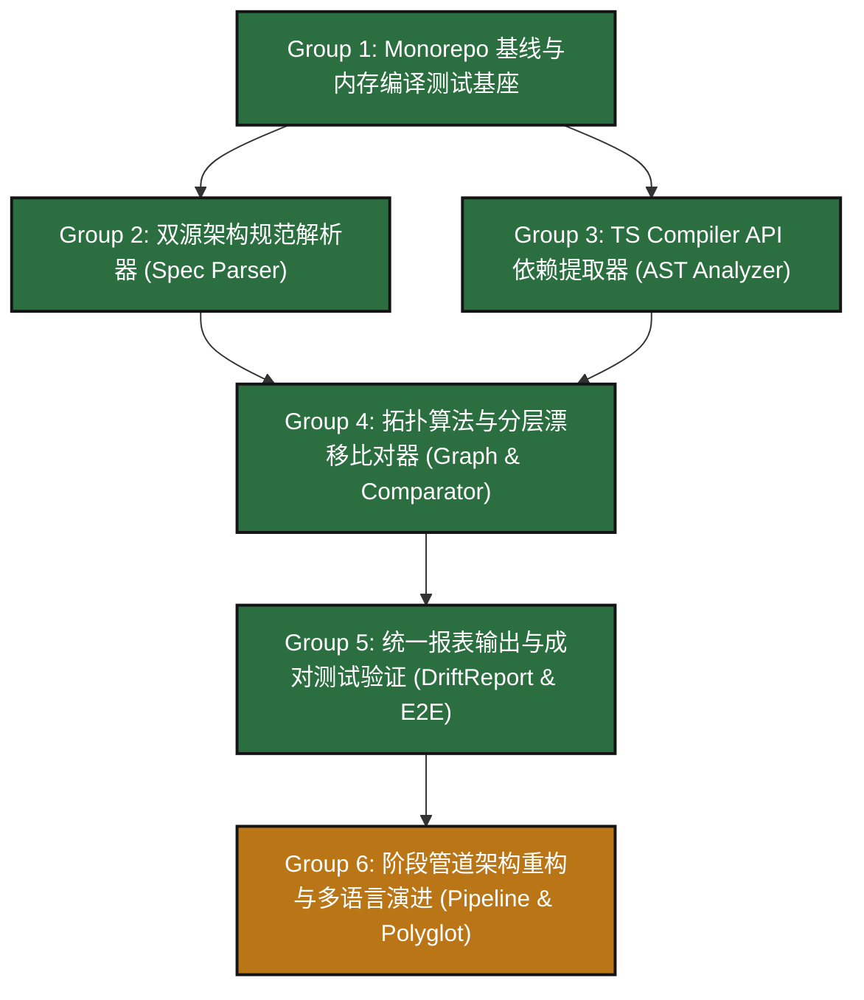

# Feature Implementation Plan: Phase 1 — Module Drift Engine

> **特性代号**：`phase-1-module-drift-engine` (SP01)  
> **制定日期**：2026-09-16（重构升级：2026-10-04）  
> **所属分支**：`feat/phase-1-module-drift-engine`  
> **基准规范**：[`requirements.md`](file:///home/redtea/Mona_project/SextantDriftV03/specs/2026-09-16-phase-1-module-drift-engine/requirements.md) | [`specs/roadmap.md`](file:///home/redtea/Mona_project/SextantDriftV03/specs/roadmap.md)  
> **执行模式**：TDD 模块化驱动，Core-First 无头先行，成对正反用例守护

---

## 任务分组概览 (Task Groups Overview)

---

## Task Group 1: Monorepo 骨架与虚拟内存编译测试基座

- **目标**：搭建符合六大戒律的物理分包拓扑，建立严格 TypeScript 编译、ESM 打包与毫秒级并发单测基准。
- **前置条件**：无

### 任务细分
- [x] **Task 1.1: pnpm Workspaces 多包管理与依赖拓扑配置**
- [x] **Task 1.2: TypeScript 严格模式配置与 tsup 编译流水线**
- [x] **Task 1.3: Vitest 毫秒级多线程测试套件与内存虚拟编译器辅助工具**

---

## Task Group 2: 双源架构规范解析器 (`packages/core/src/parser/`)

- **目标**：实现对架构设计意图（Target Architecture）的解析，支持 `sextant.json` 与 Markdown/Mermaid 双源单源事实。
- **前置条件**：Task Group 1

### 任务细分
- [x] **Task 2.1: 架构核心强类型定义 (`src/types/architecture.ts`)**
- [x] **Task 2.2: 结构化 JSON 规范解析器 (`src/parser/json-spec-parser.ts`)**
- [x] **Task 2.3: Mermaid 降级提取适配器 (`src/parser/mermaid-adapter.ts`)**
- [x] **Task 2.4: 统一规范分发中枢 (`src/parser/spec-resolver.ts`)**

---

## Task Group 3: TS Compiler API 依赖提取器 (`packages/core/src/analyzer/`)

- **目标**：100% 依托 TypeScript 官方语法树提取真实物理依赖证据，精准还原路径别名并过滤横切噪音。
- **前置条件**：Task Group 1

### 任务细分
- [x] **Task 3.1: 作用域文件爬虫 (`src/analyzer/file-scanner.ts`)**
- [x] **Task 3.2: 语法树依赖遍历器 (`src/analyzer/ast-extractor.ts`)**
- [x] **Task 3.3: 别名与模块路径还原器 (`src/analyzer/path-resolver.ts`)**
- [x] **Task 3.4: C4 噪音过滤器 (`src/analyzer/noise-filter.ts`)**

---

## Task Group 4: 拓扑算法与分层漂移比对器 (`packages/core/src/graph/` & `src/comparator/`)

- **目标**：构建有向图数据结构，运行 Tarjan SCC 算法检测循环依赖，运行分层比对算法检测旁路与逆向。
- **前置条件**：Task Group 2, Task Group 3

### 任务细分
- [x] **Task 4.1: 有向图邻接表 (`src/graph/directed-graph.ts`)**
- [x] **Task 4.2: Tarjan 强连通分量成环检测 (`src/graph/tarjan.ts`)**
- [x] **Task 4.3: 跨层旁路检测器 (`src/comparator/bypass-detector.ts`)**
- [x] **Task 4.4: 逆向依赖与违禁导入检测器 (`src/comparator/inversion-detector.ts`)**

---

## Task Group 5: 统一报表输出与成对测试验证 (`packages/core/src/index.ts` & `tests/`)

- **目标**：统筹封装 `analyzeModuleDrift` 纯函数，输出 `DriftReport`，并通过双向成对测试用例验证 0 误报与 100% 捕获。
- **前置条件**：Task Group 1 ~ Task Group 4

### 任务细分
- [x] **Task 5.1: `DriftReport` 数据契约与顶层导出 (`src/index.ts`)**
- [x] **Task 5.2: 正向合规测试夹具 (`tests/fixtures/clean-layered-app/`)**
- [x] **Task 5.3: 反向违规测试夹具 (`tests/fixtures/drifted-bypass-app/`)**
- [x] **Task 5.4: 性能与端到端回归压测 (`tests/benchmark/`)**

---

## Task Group 6: 阶段管道架构重构与多语言演进 (Pipeline & Polyglot)

- **目标**：将 570+ 行臃肿主函数解耦为清晰的 5 阶段管道架构，拆分实际图构建器，支持多语言静态依赖分析与 Barrel 穿透。
- **前置条件**：Task Group 1 ~ Task Group 5

### 任务细分
- [x] **Task 6.1: 实际图构建器抽取 (`src/pipeline/actual-graph-builder.ts`)**
  - **描述**：从主控中剥离实际依赖遍历、Python/TS 双解析与图构建逻辑，输出包含节点、依赖边、警告信息的高内聚结构。
  - **涉案文件**：
    - `packages/core/src/pipeline/actual-graph-builder.ts`
    - `packages/core/tests/analyzer/actual-graph-builder.test.ts`
  - **验收与验证**：单测覆盖正常依赖抽取与未决导入警告追踪。

- [x] **Task 6.2: 模块漂移阶段流水线引擎 (`src/pipeline/module-drift-pipeline.ts`)**
  - **描述**：建立 5 阶段独立纯函数流水线（Stage 1: Spec -> Stage 2: Files -> Stage 3: Graph -> Stage 4: Detectors -> Stage 5: Report），对外提供 `executeModuleDriftPipeline()` 与 `clearAllAnalysisCaches()`。
  - **涉案文件**：
    - `packages/core/src/pipeline/module-drift-pipeline.ts`
    - `packages/core/tests/pipeline/module-drift-pipeline.test.ts`
    - `packages/core/src/index.ts`（精简为主入口门面）
  - **验收与验证**：`analyzeModuleDrift` 委托给流水线执行，全量 67 个测试套件保持 100% 绿灯。

- [x] **Task 6.3: Python 多语言静态 AST 依赖提取器**
  - **描述**：集成 Python import 提取与路径解析，自动剔除 Python 3 标准库噪音。
  - **涉案文件**：
    - `packages/core/src/analyzer/python-ast-extractor.ts`
    - `packages/core/src/analyzer/python-resolver.ts`
    - `packages/core/tests/analyzer/python-ast-extractor.test.ts`
    - `packages/core/tests/analyzer/python-resolver.test.ts`

- [x] **Task 6.4: Barrel 文件多跳重导出追踪器**
  - **描述**：深度解析 Barrel 文件的跨层穿透，定位真实底层组件依赖。
  - **涉案文件**：
    - `packages/core/src/analyzer/barrel-tracer.ts`
    - `packages/core/tests/analyzer/barrel-tracer.test.ts`

- [x] **Task 6.5: C4 Level 2/3 分层与项目自举门禁 (Self-Dogfooding)**
  - **描述**：将自身的 Monorepo 纳入 `sextant.json` 规范核验，通过 `./start.sh --check` 实现自举 0 偏航。
  - **涉案文件**：
    - `sextant.json`
    - `packages/cli/tests/self-dogfooding.test.ts`
